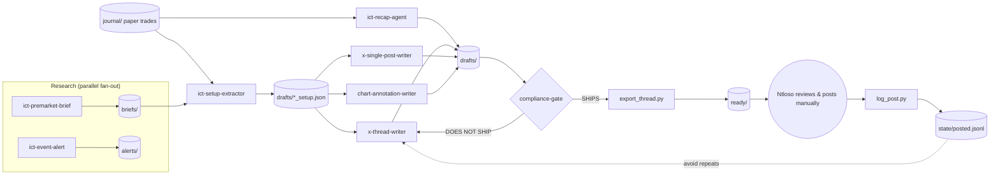

# ict-content-studio

An agentic content studio for **educational ICT (Inner Circle Trader) content on X**, built for
Claude Code by **Ntloso Ngubeni ([@GdotAiM](https://github.com/GdotAiM))** — Johannesburg (SAST),
studying NQ / US100 CFD (CAPITALCOM) on TradingView.

It researches the morning's market context, turns paper-trading journal notes into structured ICT
narratives, drafts X threads and posts, and runs every draft through a compliance gate.
**Agents only write files. A human reviews and posts every post by hand.** There is no X API posting code.

> ⚠️ Educational content only. Nothing here is financial advice or a trade signal. All trades referenced are paper trades.

Inspired by the ideas in Udacity's *Research Markets & Produce Content with Claude*
(agent files, skills, deterministic validation scripts, subagent pipelines, persistent state, gated output),
re-applied to ICT trading education. Original work; not affiliated with Udacity or ICT.

## Architecture

- **Fan-out**: the brief and the event alert are independent and can run in parallel.
- **Sequential with gates**: extractor → writer → compliance gate → export. Each step stops if its input is missing.
- **Deterministic checks**: post length (X weighted counting) and banned phrases are checked by Python scripts, never by the model.
- **Compact memory**: `state/posted.jsonl` stores topic + concepts only, so agents avoid repeating themselves without loading old posts.

## Layout
```
CLAUDE.md                      project rules (hard compliance rules)
.claude/agents/                8 subagents (YAML front matter + SOP)
.claude/skills/
  ict-glossary/                original ICT definitions
  brand-voice/                 voice guide (fill in TODOs)
  x-best-practices/scripts/    check_x_post.py, export_thread.py, xtext.py
  compliance-rules/scripts/    scan_banned.py + references/banned_phrases.txt
scripts/log_post.py            posted-topic memory
state/posted.jsonl, SCHEMA.md
briefs/ alerts/ journal/ drafts/ ready/   working dirs (content git-ignored)
examples/                      EXAMPLE DATA (fabricated)
tests/                         pytest
```

## Setup
1. Install [Claude Code](https://docs.claude.com/en/docs/claude-code) and log in.
2. `git clone https://github.com/GdotAiM/ict-content-studio && cd ict-content-studio`
3. Python 3.10+ (scripts use stdlib only). For tests: `pip install -r requirements-dev.txt && pytest -q`
4. Edit `.claude/skills/brand-voice/references/voice.md` (the `TODO(Ntloso)` lines).
5. Run `claude` in the repo root. Claude Code picks up `CLAUDE.md`, `.claude/agents/` and `.claude/skills/` automatically. Check with `/agents`.

## Running each agent
Ask Claude Code in plain language, naming the agent:
| Agent | Example prompt |
|---|---|
| ict-premarket-brief | "Use ict-premarket-brief for today. My TradingView levels: PDH …, PDL …" |
| ict-event-alert | "Run ict-event-alert for today." |
| ict-setup-extractor | "Use ict-setup-extractor on journal/2026-10-14.md" |
| x-thread-writer | "Use x-thread-writer on drafts/2026-10-14_setup.json" |
| x-single-post-writer | "Use x-single-post-writer on the concept 'fair value gap'" |
| chart-annotation-writer | "Use chart-annotation-writer on drafts/2026-10-14_setup.json" |
| ict-recap-agent | "Use ict-recap-agent for this week's journal" |
| compliance-gate | "Run compliance-gate on drafts/2026-10-14_thread.md" |

Scripts directly:
```bash
printf '%s' "My post" | python3 .claude/skills/x-best-practices/scripts/check_x_post.py --stdin
python3 .claude/skills/x-best-practices/scripts/check_x_post.py --file drafts/2026-10-14_thread.md
python3 .claude/skills/compliance-rules/scripts/scan_banned.py --file drafts/2026-10-14_thread.md
python3 .claude/skills/x-best-practices/scripts/export_thread.py --file drafts/2026-10-14_thread.md --gate-report drafts/2026-10-14_gate.md
python3 scripts/log_post.py check --concepts fvg,pdh --days 7
python3 scripts/log_post.py add --topic "FVG after PDH sweep" --concepts fvg,pdh --format thread --url https://x.com/...
```

## Daily workflow (SAST)
| Time (SAST, EDT season) | Step |
|---|---|
| ~13:00 | Run `ict-premarket-brief` + `ict-event-alert` (in parallel). Paste your own TradingView levels. |
| 14:30–17:00 | NY AM killzone — chart and **paper trade**, write `journal/YYYY-MM-DD.md`. |
| After session | `ict-setup-extractor` → `x-thread-writer` / `x-single-post-writer` → `chart-annotation-writer`. |
| Then | `compliance-gate`; on SHIPS, `export_thread.py` writes `ready/…_thread.md`. |
| You | Read it, screenshot + annotate the chart, **post manually on X**, then `log_post.py add`. |
| Weekly | `ict-recap-agent` for process review. |
(During US winter time (EST), add 1 hour to SAST times.)

## Manual levels input
Copy `inputs/levels_TEMPLATE.md` to `inputs/levels_YYYY-MM-DD.md`, fill it from TradingView
(CAPITALCOM:US100), and validate with `python3 scripts/load_levels.py inputs/levels_YYYY-MM-DD.md`.
`ict-premarket-brief` prefers this file over web sources. Daily files are gitignored.

## TradingView access
TODO: A direct TradingView connection is being evaluated. Until then, levels are entered manually
via `inputs/levels_YYYY-MM-DD.md`.

## Compliance stance
- Educational only; no buy/sell signals, entries/stops/targets for live markets, profit promises, or "guaranteed" language.
- Paper trading only, labelled as such.
- Every price/event fact carries a source and ET + SAST timestamp; otherwise it's UNVERIFIED and does not ship.
- `compliance-gate` must return **SHIPS** and both scripts must exit 0 before `ready/` is written; `export_thread.py` enforces this.
- Humans post. No posting automation will be added.
- Regulations differ by country (e.g. FSCA in South Africa); this tool does not make content compliant on its own — you remain responsible.

## License
MIT — see [LICENSE](LICENSE).
